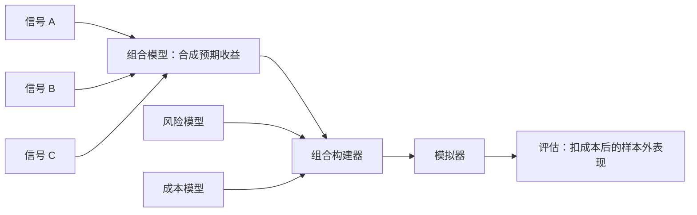

# 架构

本文描述系统分几层、每层负责什么、数据怎样流动。它是 Phase 1 开始写代码时的依据。标注"提议"的部分对应[决策记录](decisions/)里尚待所有者确认的条目。

## 1. 分层

```mermaid
flowchart TB
  subgraph L0["第 0 层 · 治理"]
    G1["科研规程"]
    G2["注册表：假说、试验账本、关系、数据源、决策日志"]
  end
  subgraph L1["第 1 层 · 数据"]
    D1["采集器"] --> D2["原始层：原样保存，只增不改"]
    D2 --> D3["规范层：统一格式，带三个时间"]
    D3 --> D4["特征层：时点正确的派生量"]
  end
  subgraph L2["第 2 层 · 内核库"]
    K1["时间与溯源"]
    K2["统计推断"]
    K3["模拟与成本"]
    K4["关系与资金流度量"]
    K5["风险与仓位"]
  end
  subgraph L3["第 3 层 · 研究：产出信号"]
    P1["短周期价格与订单流"]
    P2["衍生品定位"]
    P3["跨市场关系"]
    P4["期权流"]
    P5["宏观与流动性"]
  end
  subgraph L4["第 4 层 · 统一模型"]
    M1["信号库"] --> M2["组合模型"]
    M2 --> M3["组合构建：成本、风险"]
    M3 --> M4["模拟器"]
  end
  subgraph L5["第 5 层 · 运行"]
    O1["定时采集"]
    O2["数据质量与新鲜度监控"]
    O3["模拟盘"]
  end
  subgraph L6["第 6 层 · 决策"]
    C1["结论库"]
    C2["资金决策"]
  end
  L0 -.->|约束每一次研究| L3
  L0 -.->|约束每一次修改| L4
  L5 --> L1
  L1 --> L3
  L2 --> L3
  L2 --> L4
  L3 -->|信号| L4
  L4 --> L6
```



| 层 | 职责 | 改动的代价 |
|---|---|---|
| 0 治理 | 规定什么算结论，记录做过什么 | 最高。历史记录缺失后无法补回 |
| 1 数据 | 把外部数据变成时点正确、可追溯的表 | 高。原始数据错过就没有了；时间语义定错要全部重建 |
| 2 内核库 | 可复用、有测试的计算 | 中。接口稳定后内部可以重写 |
| 3 研究 | 提出假说，把通过检验的发现做成信号 | 低。每个项目独立 |
| 4 统一模型 | 把全部信号合成一个组合，扣除成本和风险后评估 | 中。接口要早定；组合方式可以替换，但每次替换都计入试验账本 |
| 5 运行 | 让第 1 层持续运转，并监控它 | 低 |
| 6 决策 | 把模型和结论变成资金配置 | 低，但每个决策都要留痕 |

落地顺序基本按"改动代价从高到低"排列，详见[落地顺序](roadmap.md)。

## 2. 数据模型

### 2.1 三个时间

每条数据带三个时间字段：

| 字段 | 含义 | 例子：美国 10 月 CPI |
|---|---|---|
| `event_time` | 数据描述的时刻或时期 | 2026-10-31 |
| `available_at` | 公众最早能知道它的时刻 | 2026-11 中旬的公布时刻 |
| `ingested_at` | 我们抓取到它的时刻 | 抓取任务运行的时刻 |

研究代码只按 `available_at` 取数据。对于行情，`available_at` 等于事件时间加上数据源的延迟。对于没有历史、靠每天录制的数据，`available_at` 取 `ingested_at`。

会被修订的数据（多数宏观指标）同一个 `event_time` 有多条记录，每条对应一次公布。按时点查询时取"当时最新的那一条"。

### 2.2 三层存储

| 层 | 内容 | 规则 |
|---|---|---|
| 原始层 | 接口返回的原始字节，压缩保存，旁边附一个元数据文件：地址、参数、抓取时间、状态码、内容指纹、采集器版本 | 只增不改不删。例外见下文 |
| 规范层 | 按统一格式整理的 Parquet 表，按数据集和日期分区，带格式版本号 | 可随时删除，由原始层和代码重建 |
| 特征层 | 派生量，例如净 GEX、年化基差、订单流失衡 | 由规范层和代码计算，按指纹缓存 |

原始层是唯一不可替代的资产。代码写错了可以重算，原始数据没存就永远没有了。

例外：如果数据源是长期公开、可以随时重新下载、并且提供官方校验和的归档（例如 Binance 公开数据站的逐笔成交文件），原始层只记录文件地址、官方校验和与下载时间，不保存字节本身。需要时重新下载，校验和不一致即报错。这类数据量极大，全部保存既不现实也没有必要。数据源是否属于这一类，在数据源目录里逐个登记。

### 2.3 时点查询接口

研究代码不直接读文件，只通过一个接口取数据。接口的含义是"在时刻 t，这张表里能知道的全部内容"。

每次研究运行有一个时钟上限。查询的时刻超过上限就报错。金库就是把上限设在封存边界上：没有所有者批准的令牌，任何查询都越不过去，而令牌的每次使用都写入账本。

这样，不前视和不碰金库都由接口保证，不依赖写代码的人或 AI 的自觉。

### 2.4 溯源

每个结果附带一份运行清单（`src/finresearch/core/provenance.py`）：

| 字段 | 含义 |
|---|---|
| 代码版本 | git 提交号，以及工作区是否有未提交的改动 |
| 数据版本 | 用到的每个分区的内容指纹，按名称记录 |
| 配置指纹 | 全部参数的指纹 |
| 环境指纹 | 依赖锁定文件、Python 版本、处理器架构和操作系统的指纹。不同处理器上的浮点计算可能有细微差别，所以架构也计入 |
| 随机种子 | 非负整数 |
| 时钟上限 | 这次运行最远能看到的时刻 |

这些字段、且只有这些字段合成结果指纹。同一个结果指纹再跑一次，必须得到逐位相同的输出，这一点由持续集成检查（Phase 1.6）。工作区有未提交改动时，运行清单标记为"不可重算"，这样的运行不能写入试验账本。

**指纹的规则**（`src/finresearch/core/fingerprint.py`）：

- 指纹是 SHA-256 摘要，写作 `sha256:<64 位十六进制>`。
- 结构化的值（参数、运行清单）先转成唯一的字节串再取摘要：键按字母排序、没有空白、UTF-8 编码、只接受有限数值，时间一律转成标准 UTC 文本。没有确定顺序的类型（集合）直接拒绝，不替它排序。
- 目录的指纹只取决于其中每个文件的相对路径和内容，与创建顺序、修改时间、权限、所在位置都无关。空目录不计；符号链接直接拒绝。
- 这些规则一旦改变，历史上记录的所有指纹都会失效，所以由格式锚定测试锁住。确实需要改时，提升运行清单的版本号，不改动旧的锚定值。

### 2.5 时间、日历与标识

这三样东西出错时不会报错，只会让结果悄悄变错，所以在内核库最底层统一处理（`src/finresearch/core/`）。

**时间。**

- 所有时刻都是带时区的 UTC 时间，不带时区的时间在进入系统时就被拒绝。
- 交易所发布的整数时间戳按毫秒或微秒理解；换算成更粗的单位时一律向过去取整，取整永远不会把时间推向未来。
- 当地时区的规则来自锁定版本的 `tzdata` 包，而不是运行机器上的系统时区，所以夏令时的换算在任何机器上都一样。

**交易日历。**

| 类型 | 适用 | 交易日 |
|---|---|---|
| 全天交易 | 加密市场 | 每个 UTC 自然日 |
| 交易所 | 纽交所等 | 当地时间的固定时段，扣除节假日，部分日子提前收盘；按 `tzdata` 换算成 UTC |

交易所日历只认识它覆盖范围内的节假日。问到范围之外的日期时直接报错，因为一个会猜的日历会把数据放到市场根本没开的日子上。节假日表和交易时段在 `config/calendars.toml`，每份都注明来源。

**品种标识。**

| 层级 | 例子 | 含义 |
|---|---|---|
| 代码键 | `binance:perp:ABCUSDT` | 交易所现在怎么称呼它。交易所会在品种下架后把代码重新分配给新品种，所以它不是长期身份 |
| 品种身份 | `binance:perp:ABCUSDT@2021-03-01` | 代码键加上市日期。永久唯一，作用相当于研究数据库给每只股票分配的永久编号 |

上市表记录每个品种身份在交易所上的存续区间，以及它的基础资产、计价资产和合约乘数。它回答两个问题：某个时刻某个代码指的是哪个品种；某个时刻同一个标的在各个交易所对应哪些品种。上市表的内容来自各交易所自己的品种信息，在 Phase 2 填入。

## 3. 注册表

注册表是治理层的机器可读部分，放在仓库里，随代码一起做版本管理。

| 文件 | 格式 | 内容 | 写入规则 |
|---|---|---|---|
| `registry/hypotheses/` | 每个假说一个 TOML | 假说卡：机制、对手、证伪条件、检验方案、状态记录 | 状态只能追加；注册时记下方案指纹，此后方案不能改 |
| `registry/trials.jsonl` | 每行一条 JSON | 试验账本：每次在真实数据上产出绩效指标的运行 | 只追加，由程序自动写，每行带前一行的指纹 |
| `registry/owner_decisions.jsonl` | 每行一条 JSON | 所有者的决定：开启金库、放行到下一级、资金配置，以及依据 | 只追加，每行带前一行的指纹 |
| `registry/relations/` | 每条关系一个 TOML | 无套利关系：品种、公式、成本模型、价差存在的原因 | 可修订，历史在 git 里 |
| `registry/sources/` | 每个数据源一个 TOML | 数据源目录：地址、访问方式、能否重新下载、时间语义、限流、使用条款、已知问题 | 可修订，历史在 git 里 |

格式用 TOML 和 JSON，都由标准库读取；校验用 pydantic。`owner_decisions.jsonl` 是所有者的具体决定，与 `docs/decisions/` 里的设计决策记录不同。

持续集成运行两项检查：

- **`finresearch registry check`**：每个文件的格式，以及跨文件的规程规则（见[科研规程](protocol.md)第 7 节）。
- **`finresearch registry check-append-only --base <上一个版本>`**：账本必须是上一个版本的逐字节延续；假说卡已有的状态记录不能改，已注册的检验方案不能改，假说卡不能删除。

账本内的指纹链能发现任何一行被改动；与 git 历史的比对能发现整条链被重新生成。两者缺一不可。

报告里引用的每个结果都必须在账本里有对应记录，这项检查在 Phase 1.6 有了标准报告之后加上。

## 4. 内核库

```
src/finresearch/
  core/        时间与日历、标识符、配置、溯源
  data/        采集器、存储、格式校验、时点查询
  stats/       多重检验、自助法、交叉验证、功效计算
  model/       信号接口、组合模型、组合构建
  sim/         事件驱动的模拟器、成交与成本模型
  relations/   无套利关系的计算与残差
  flows/       订单流和期权流的度量
  risk/        风险度量、仓位、回撤控制
  report/      标准报告的生成
```

约定：

- 计算尽量写成纯函数，输入输出明确，不读写全局状态。
- 可调的数字全部放在配置文件里，代码里不出现魔法数字。配置文件用 TOML 格式，由标准库读取，不增加依赖。
- 每个非平凡的函数都有一个手算期望值的测试。
- 时间一律用带时区的 UTC。

## 5. 统一模型

所有研究的产出都是信号，所有信号进入同一个模型（[决策 0006](decisions/0006-single-model.md)）。这是参照文艺复兴大奖章的做法，理由见[以文艺复兴为参照](renaissance.md)。



### 5.1 信号接口

| 字段 | 含义 |
|---|---|
| 名称与版本 | 信号的任何改动都产生新版本 |
| 来源假说 | 对应的假说卡编号 |
| 研究宇宙 | 对哪些品种给出预测 |
| 预测周期 | 预测未来多长时间的收益，例如 1 小时、1 天 |
| 输出 | 每个品种、每个时刻的一个标准化得分 |
| 可用时间 | 得分在什么时刻可以被知道 |

信号只能通过时点查询接口取数据，所以它在接口层面就不可能用到未来的信息。

### 5.2 组合模型

把各个信号的得分合成每个品种的预期收益。

- **换算到同一个单位。** 每个信号先换算成预期收益：大约等于"这个信号历史上的预测能力 × 该品种的波动率 × 标准化得分"。不同信号由此可以直接相加。
- **按收缩后的权重相加。** 权重在探索集上估计，考虑信号之间的相关性，并向等权收缩。
- **第一版是线性的。** 更复杂的组合方式，只有在样本外证明了自己之后才替换线性版本。组合模型的每一次修改都计入试验账本。

### 5.3 组合构建

在约束之下，使"预期收益 − 风险惩罚 − 交易成本"最大。

- **约束**：总杠杆、单个品种的上限、成交量参与率的上限、最低有效广度。
- **风险模型**：带收缩的协方差估计，加上压力情景（包括同类策略集体平仓）。
- **自动降风险**：按波动率调整总仓位，按回撤规则收缩。规则事先写好，由程序执行，不由人临时判断。
- **宏观与流动性**：作为风险缩放的输入进入这里，不作为方向信号。

### 5.4 模拟器

- 事件驱动，与将来的模拟盘共用同一套代码。
- 成交规则保守：市价单按下一个可成交价格成交，限价单必须被价格穿过才算成交。
- 成本包括手续费、买卖价差、资金费率和冲击成本。冲击成本随成交量占市场成交量的比例上升。
- 输出包括容量估计：资金规模扩大到多少时，优势被自身的交易成本吃掉。

### 5.5 边际贡献

新信号的检验方法：在相同的数据、相同的约束下，分别运行"包含它"和"不包含它"的整体模型，比较两者扣成本后的样本外表现。这个差值是信号的价值，它的显著性按[科研规程](protocol.md)第 6 节检验。

## 6. 研究宇宙与研究项目

### 6.1 研究宇宙

| 宇宙 | 内容 | 优先级 |
|---|---|---|
| U1 加密永续合约 | Binance、Bybit 的全部 USDT 永续合约，包括已下架的品种 | 第一，见[决策 0007](decisions/0007-breadth-first-universe.md) |
| U2 美股 ETF 与期权 | 日线；自己录制的期权链 | 第二 |
| 宏观与利率 | 利率、利差、波动率指数、商品 | 作为风险输入，不单独构成宇宙 |

### 6.2 研究项目

项目之间互不依赖，只依赖内核库，各自产出信号。

| 项目 | 研究对象 | 宇宙 |
|---|---|---|
| P0 元研究 | 研究流程本身的误报率和检出率 | 合成数据 |
| P1 短周期价格与订单流 | 反转、动量、主动买卖失衡、成交量冲击 | U1 |
| P2 衍生品定位 | 资金费率、持仓量变化、基差、强制平仓 | U1 |
| P3 跨市场关系 | 同一品种在不同交易所之间的价差与领先滞后；现货、期货、期权之间无套利关系的残差 | U1、U2 |
| P4 期权流 | 做市商 Gamma 头寸、偏斜、波动率风险溢价 | U1 的 Deribit 期权，U2 |
| P5 宏观与流动性 | 只产出风险缩放，不产出方向信号 | 全部 |

## 7. 运行环境

### 7.1 计算

全部在 GitHub Actions 上运行，分四类工作流：

| 工作流 | 触发 | 作用 |
|---|---|---|
| 持续集成 | 每次提交 | 代码风格、类型检查、测试、注册表校验 |
| 采集 | 定时 | 抓取数据写入原始层，更新规范层 |
| 监控 | 定时 | 检查数据新鲜度和质量，异常时通知 |
| 研究运行 | 手动 | 执行一次已登记的试验，把结果和账本记录提交回仓库 |

### 7.2 存储（提议，见决策记录 0003）

代码仓库不存放数据。数据放在独立的私有存储里，通过一个统一的文件系统接口访问，更换后端只需要改配置。Phase 1 用不到远程存储，这个决定可以推迟到 Phase 2 开始时。

### 7.3 已经核实的约束

| 约束 | 数值 | 来源 |
|---|---|---|
| 公开仓库使用标准运行器 | 免费 | [GitHub 文档](https://docs.github.com/en/billing/managing-billing-for-github-actions/about-billing-for-github-actions) |
| 私有仓库（免费账户） | 每月 2,000 分钟 | 同上 |
| 单个文件 | 超过 100 MiB 被拒绝 | [GitHub 文档](https://docs.github.com/en/repositories/working-with-files/managing-large-files/about-large-files-on-github) |
| 仓库体积 | 建议 1 GB 以内 | 同上 |
| Hugging Face 免费账户 | 私有存储 100 GB | [Hugging Face 文档](https://huggingface.co/docs/hub/storage-limits) |
| Cloudflare R2 免费额度 | 每月 10 GB，流出流量不收费 | [Cloudflare](https://www.cloudflare.com/developer-platform/r2/) |
| Binance 接口 | 拒绝美国 IP；公开行情可改用 `data-api.binance.vision` 和 `data.binance.vision` | [Binance 文档](https://developers.binance.com/docs/binance-spot-api-docs/rest-api/public-api-definitions)；实测 |
| Binance 公开数据站 | 1,000 个以上永续合约的逐笔成交，含已下架品种；BTCUSDT 单日约 18 MB | 2026-11-13 实测，见[决策 0007](decisions/0007-breadth-first-universe.md) |
| CBOE 延迟期权链原始文件 | SPX、SPY、QQQ、IBIT 四个标的压缩后合计约 3.5 MB/天，一年约 0.9 GB | 2026-11-13 实测 |

### 7.4 尚未核实，Phase 2 开始前要查清的事

- 公开仓库长期没有提交时，定时工作流是否会被自动停用，以及怎样避免。
- FRED 历史公布版本（宏观数据修订前的值）的免费获取方式。
- 每个数据源的使用条款是否允许个人存档和研究使用，尤其是 Binance 和 Bybit 的公开归档。
- Bybit 公开归档是否包含已下架品种，以及最早的日期。
- 从 GitHub Actions 读写 Hugging Face 或 R2 的速度和稳定性。

## 8. AI 助手的位置

AI 助手是研究委员会里各个角色的执行者（见[跨学科分析](disciplines.md)末尾），受以下规则约束：

| 可以做 | 不可以做 |
|---|---|
| 提出假说、起草假说卡、实现信号 | 修改已冻结的检验方案 |
| 写代码和测试 | 改动或删除账本里的历史记录 |
| 在探索集上运行试验（自动记账） | 接触金库 |
| 写报告、审查别人的报告 | 审查自己提出的结论 |
| 发现问题时提出修订规程的建议 | 自行放行到下一级闸门 |

这些规则写在仓库根目录的 `CLAUDE.md` 里，其中能自动检查的部分由持续集成强制执行。
