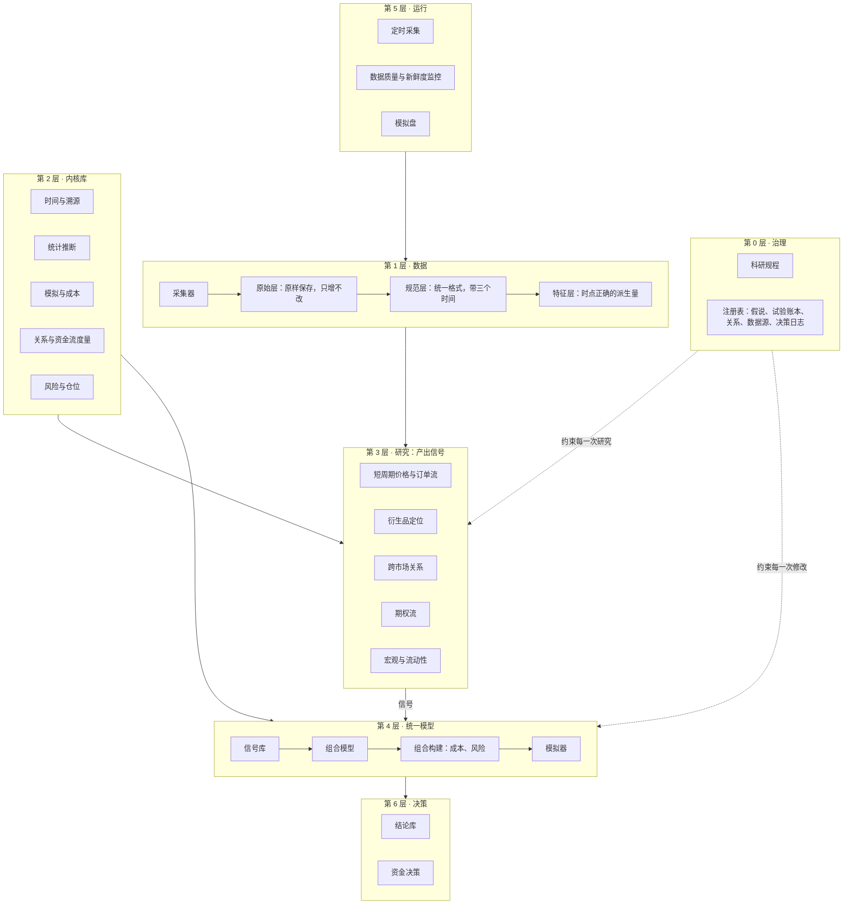
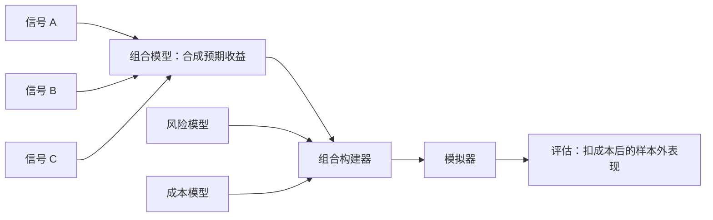

# 架构

本文描述系统分几层、每层负责什么、数据怎样流动。它是 Phase 1 开始写代码时的依据。标注"提议"的部分对应[决策记录](decisions/)里尚待所有者确认的条目。

## 1. 分层



| 层 | 职责 | 改动的代价 |
|---|---|---|
| 0 治理 | 规定什么算结论，记录做过什么 | 最高。历史记录缺失后无法补回 |
| 1 数据 | 把外部数据变成时点正确、可追溯的表 | 高。原始数据错过就没有了；时间语义定错要全部重建 |
| 2 内核库 | 可复用、有测试的计算 | 中。接口稳定后内部可以重写 |
| 3 研究 | 提出假说，把通过检验的发现做成信号 | 低。每个项目独立 |
| 4 统一模型 | 把全部信号合成一个组合，扣除成本和风险后评估 | 中。接口要早定；组合方式可以替换，但每次替换都计入试验账本 |
| 5 运行 | 让第 1 层持续运转，并监控它 | 低 |
| 6 决策 | 把模型和结论变成资金配置 | 低，但每个决策都要留痕 |

落地顺序基本按"改动代价从高到低"排列，详见[落地顺序](roadmap.md)。

## 2. 数据模型

### 2.1 三个时间

每条数据带三个时间字段：

| 字段 | 含义 | 例子：美国 10 月 CPI |
|---|---|---|
| `event_time` | 数据描述的时刻或时期 | 2026-10-31 |
| `available_at` | 公众最早能知道它的时刻 | 2026-11 中旬的公布时刻 |
| `ingested_at` | 我们抓取到它的时刻 | 抓取任务运行的时刻 |

研究代码只按 `available_at` 取数据。对于行情，`available_at` 等于事件时间加上数据源的延迟。对于没有历史、靠每天录制的数据，`available_at` 取 `ingested_at`。

会被修订的数据（多数宏观指标）同一个 `event_time` 有多条记录，每条对应一次公布。按时点查询时取"当时最新的那一条"。

### 2.2 三层存储

| 层 | 内容 | 规则 |
|---|---|---|
| 原始层 | 接口返回的原始字节，压缩保存，旁边附一个元数据文件：地址、参数、抓取时间、状态码、内容指纹、采集器版本 | 只增不改不删。例外见下文 |
| 规范层 | 按统一格式整理的 Parquet 表，按数据集和日期分区，带格式版本号 | 可随时删除，由原始层和代码重建 |
| 特征层 | 派生量，例如净 GEX、年化基差、订单流失衡 | 由规范层和代码计算，按指纹缓存 |

原始层是唯一不可替代的资产。代码写错了可以重算，原始数据没存就永远没有了。

实现：原始层在 `src/finresearch/data/raw.py`，每个响应原样保存（gzip，固定文件头，相同输入得到相同文件），旁边的元数据文件记录来源、地址、抓取时间和内容指纹，同名文件已存在即报错；读回时核对指纹。路径按 `raw/<数据源>/<年>/<月>/<日>/` 分层，让每个文件夹远低于远程存储一万个条目的上限。规范层在 `src/finresearch/data/catalog.py`，由原始层和解析代码生成，一张表一个 Parquet 文件。

**远程存储**（`src/finresearch/data/store.py`、`hub.py`）。所有代码都只读写本地目录。一个任务开始时从远程存储拉取它需要的部分，结束时把新增的文件推上去：

- **只追加。** 远程已有的路径永远不被替换。推送同样的字节什么也不做（所以任务重试无害）；推送不同的字节直接报错。
- **攒批提交。** 每次提交最多 50 个文件（配置在 `config/storage.toml`）；推送前检查每个文件夹的条目数不超过上限。
- **防并发。** 每次提交都写明它基于哪个版本。别的任务抢先提交时，这次提交失败，推送重新列出远程内容，只补上还缺的文件。
- **区分错误。** 令牌错误、仓库不存在属于永久错误，立即报错；网络中断、服务端繁忙属于临时错误，按配置重试。
- **自检。** `finresearch storage selftest` 写入随机字节、读回、核对指纹、计时，最后删除；由手动触发的"存储自检"工作流在 GitHub Actions 上运行。

例外：如果数据源是长期公开、可以随时重新下载、并且提供官方校验和的归档（例如 Binance 公开数据站的逐笔成交文件），原始层只记录文件地址、官方校验和与下载时间，不保存字节本身。需要时重新下载，校验和不一致即报错。这类数据量极大，全部保存既不现实也没有必要。数据源是否属于这一类，在数据源目录里逐个登记。

### 2.3 时点查询接口

研究代码不直接读文件，只通过一个接口取数据（`src/finresearch/data/pit.py`）。接口的含义是"在时刻 t，这张表里能知道的全部内容"：只返回公布时间不晚于 t 的数据；同一个观测有多个版本时，返回 t 时最新的那一版。

**时钟。** 每次研究运行有一个时钟上限，查询的时刻超过上限就报错。上限由假说卡和数据段自动推出：

| 数据段 | 时钟上限 | 前提 |
|---|---|---|
| 探索 | 探索段最后一天的最后一刻 | — |
| 确认 | 确认段最后一天的最后一刻 | 假说已注册 |
| 金库 | 金库段最后一天的最后一刻 | 已注册，并持有该假说的金库令牌 |
| 前向 | 运行的当下 | 已注册，并持有金库令牌（前向数据在金库之后，越过金库必须先开启它） |
| 合成数据 | 运行的当下 | 不涉及真实数据，没有金库 |

**金库。** 时钟上限一旦越过金库的起点，没有令牌连时钟都建不起来。令牌只能凭所有者在 `registry/owner_decisions.jsonl` 里对该假说的开启决定换取；用到令牌的试验必须在账本里引用这个决定（第 3 节）。

**溯源。** 接口记下每张被读过的表和它的内容指纹，直接成为运行清单里的数据版本。表的内容指纹只取决于逻辑内容（列按名称排序、行按键和时间排序），与行的顺序、分块方式和文件格式无关。

**不能绕过。** 一项结构测试扫描 `finresearch.data` 之外的全部代码，禁止直接读取数据文件的库（Parquet、CSV、DuckDB、pandas 等），也禁止调用接口内部不带时钟的函数。

**研究代码拿不到表。** 运行框架把一组表放进接口，交给研究代码的只有接口本身；研究代码按名称查询，拿到的是"某张表在某一时刻的样子"（`Snapshot`），不是表。

**决策时点视图。** `pit.view(t)` 返回同一组表、但时钟停在 t 的接口。研究代码在每个决策时刻 t 都在这个视图里取数，t 之后公布的数据（包括之后才出现的修订值）不是"不该用"，而是取不到。视图与原接口共用溯源记录。

**拒绝都留下记录。** 接口拒绝的请求分三类：查询时刻超过时钟上限（前视）、没有令牌进入金库、假说未注册就要确认集或金库的数据。被拒绝的请求不返回任何数据，运行框架把每一次拒绝写进 `registry/refusals.jsonl`（第 3 节）。

这样，不前视和不碰金库都由接口保证，不依赖写代码的人或 AI 的自觉。研究代码（`src/finresearch/studies/`）受更严的结构测试约束：只能从数据层引用接口本身，不能引用数据源（合成数据源会直接交出真相）、运行框架和注册表，也不能读写文件、启动进程或访问网络。

pyarrow 没有完整的类型标注，所有直接调用它的代码集中在 `src/finresearch/data/table.py` 一个文件里，只在这个文件放宽类型检查；其余代码保持最严格的标准。

### 2.4 溯源

每个结果附带一份运行清单（`src/finresearch/core/provenance.py`）：

| 字段 | 含义 |
|---|---|
| 代码版本 | git 提交号，以及工作区是否有未提交的改动 |
| 数据版本 | 用到的每个分区的内容指纹，按名称记录 |
| 配置指纹 | 全部参数的指纹 |
| 环境指纹 | 依赖锁定文件、Python 版本、处理器架构和操作系统的指纹。不同处理器上的浮点计算可能有细微差别，所以架构也计入 |
| 随机种子 | 非负整数 |
| 时钟上限 | 这次运行最远能看到的时刻 |

这些字段、且只有这些字段合成结果指纹。同一个结果指纹再跑一次，必须得到逐位相同的输出，这一点由持续集成检查（Phase 1.6）。工作区有未提交改动时，运行清单标记为"不可重算"，这样的运行不能写入试验账本。

**指纹的规则**（`src/finresearch/core/fingerprint.py`）：

- 指纹是 SHA-256 摘要，写作 `sha256:<64 位十六进制>`。
- 结构化的值（参数、运行清单）先转成唯一的字节串再取摘要：键按字母排序、没有空白、UTF-8 编码、只接受有限数值，时间一律转成标准 UTC 文本。没有确定顺序的类型（集合）直接拒绝，不替它排序。
- 目录的指纹只取决于其中每个文件的相对路径和内容，与创建顺序、修改时间、权限、所在位置都无关。空目录不计；符号链接直接拒绝。
- 这些规则一旦改变，历史上记录的所有指纹都会失效，所以由格式锚定测试锁住。确实需要改时，提升运行清单的版本号，不改动旧的锚定值。

### 2.5 时间、日历与标识

这三样东西出错时不会报错，只会让结果悄悄变错，所以在内核库最底层统一处理（`src/finresearch/core/`）。

**时间。**

- 所有时刻都是带时区的 UTC 时间，不带时区的时间在进入系统时就被拒绝。
- 交易所发布的整数时间戳按毫秒或微秒理解；换算成更粗的单位时一律向过去取整，取整永远不会把时间推向未来。
- 当地时区的规则来自锁定版本的 `tzdata` 包，而不是运行机器上的系统时区，所以夏令时的换算在任何机器上都一样。

**交易日历。**

| 类型 | 适用 | 交易日 |
|---|---|---|
| 全天交易 | 加密市场 | 每个 UTC 自然日 |
| 交易所 | 纽交所等 | 当地时间的固定时段，扣除节假日，部分日子提前收盘；按 `tzdata` 换算成 UTC |

交易所日历只认识它覆盖范围内的节假日。问到范围之外的日期时直接报错，因为一个会猜的日历会把数据放到市场根本没开的日子上。节假日表和交易时段在 `config/calendars.toml`，每份都注明来源。

**品种标识。**

| 层级 | 例子 | 含义 |
|---|---|---|
| 代码键 | `binance:perp:ABCUSDT` | 交易所现在怎么称呼它。交易所会在品种下架后把代码重新分配给新品种，所以它不是长期身份 |
| 品种身份 | `binance:perp:ABCUSDT@2021-03-01` | 代码键加上市日期。永久唯一，作用相当于研究数据库给每只股票分配的永久编号 |

上市表记录每个品种身份在交易所上的存续区间，以及它的基础资产、计价资产和合约乘数。它回答两个问题：某个时刻某个代码指的是哪个品种；某个时刻同一个标的在各个交易所对应哪些品种。上市表的内容来自各交易所自己的品种信息，在 Phase 2 填入。

## 3. 注册表

注册表是治理层的机器可读部分，放在仓库里，随代码一起做版本管理。

| 文件 | 格式 | 内容 | 写入规则 |
|---|---|---|---|
| `registry/hypotheses/` | 每个假说一个 TOML | 假说卡：机制、对手、证伪条件、检验方案、状态记录 | 状态只能追加；注册时记下方案指纹，此后方案不能改 |
| `registry/trials.jsonl` | 每行一条 JSON | 试验账本：每次在真实数据上产出绩效指标的运行 | 只追加，由程序自动写，每行带前一行的指纹 |
| `registry/owner_decisions.jsonl` | 每行一条 JSON | 所有者的决定：开启金库、放行到下一级、资金配置，以及依据 | 只追加，每行带前一行的指纹 |
| `registry/refusals.jsonl` | 每行一条 JSON | 拒绝记录：时点查询接口拒绝的每一次请求（前视、金库、未注册），以及当时的代码版本 | 只追加，由程序自动写，每行带前一行的指纹 |
| `reports/` | 每次试验一个 Markdown | 标准报告（科研规程第 8 节），文件名就是试验编号 | 由程序生成，不手工修改 |
| `registry/relations/` | 每条关系一个 TOML | 无套利关系：品种、公式、成本模型、价差存在的原因 | 可修订，历史在 git 里 |
| `registry/sources/` | 每个数据源一个 TOML | 数据源目录：地址、访问方式、能否重新下载、时间语义、限流、使用条款、已知问题 | 可修订，历史在 git 里 |

格式用 TOML 和 JSON，都由标准库读取；校验用 pydantic。`owner_decisions.jsonl` 是所有者的具体决定，与 `docs/decisions/` 里的设计决策记录不同。

持续集成运行四项检查：

- **`finresearch registry check`**：每个文件的格式，以及跨文件的规程规则（见[科研规程](protocol.md)第 7 节）。其中包括报告与账本互相对应：每条试验都有标准报告，每份报告都有对应的试验，报告抬头的指纹与账本一致，正文的指纹等于账本里的输出指纹（正文被改过一个字就不一致）。
- **`finresearch registry check-append-only --base <上一个版本>`**：三个只追加文件都必须是上一个版本的逐字节延续；假说卡已有的状态记录不能改，已注册的检验方案不能改，假说卡不能删除。
- **`finresearch registry check-commits`**：账本记录的每个代码版本都在当前的 git 历史里。否则那次试验永远无法重跑。因此拉取请求只用合并提交（merge commit）合并，不用压缩合并（squash）或变基合并（rebase），两者都会让分支上的提交从历史里消失。
- **`finresearch reproduce --synthetic`**：重跑账本里全部合成数据上的试验（见 3.1）。

账本内的指纹链能发现任何一行被改动；与 git 历史的比对能发现整条链被重新生成。两者缺一不可。

### 3.1 运行框架

一次运行（`src/finresearch/runner.py`，命令 `finresearch run`）依次做这些事：

1. 读注册表和假说卡。研究只能读假说卡 `data` 里登记过的数据源。
2. 在写任何文件之前记下代码版本，干净的工作区才会被记为干净。
3. 按数据段建时钟（2.3）。金库和前向数据需要所有者的令牌，确认集需要假说已注册。
4. 在一个空白目录里重建数据：抓取 → 原始层 → 规范层 → 表 → 时点查询接口。
5. 研究在接口后面运行，写出标准报告的正文。第 2 节（假说）和第 12 节（运行清单）由框架按注册表填写，第 3 节末尾附上读过的每张表的内容指纹。
6. 带 `--record` 时追加账本，写出报告。工作区有未提交的改动时拒绝入账。

报告分两部分：抬头（试验编号、记录时间、两个指纹）只有入账后才有；正文只取决于运行的输入，所以同一个代码版本、同样的数据重跑，正文逐字节相同。正文的指纹就是账本里的输出指纹。

**重现**（`finresearch reproduce`）：在临时的 git 工作树里检出账本记录的代码版本，按那个版本的锁定文件安装环境，从空白目录重跑，核对结果指纹和输出指纹。结果指纹一致说明输入（代码、环境、配置、数据、种子、时钟）完全相同；输出指纹一致说明算出来的东西完全相同。

记账的顺序因此是：先提交代码，在干净的工作区上运行并入账，再把账本和报告作为下一个提交。

## 4. 内核库

```
src/finresearch/
  core/        时间与日历、标识符、配置、溯源
  data/        存储（原始层、规范层）、格式校验、时点查询
  sources/     数据源：抓取原始响应，解析成时点表
  registry/    注册表的格式、账本、校验
  studies/     研究：只拿到时点查询接口和配置
  runner.py    运行框架：运行、记账、标准报告、重现
  stats/       多重检验、自助法、交叉验证、功效计算
  model/       信号接口、组合模型、组合构建
  sim/         事件驱动的模拟器、成交与成本模型
  relations/   无套利关系的计算与残差
  flows/       订单流和期权流的度量
  risk/        风险度量、仓位、回撤控制
  report/      标准报告的格式
```

目前已有的是 `core/`、`data/`、`sources/`（只有合成数据源）、`registry/`、`studies/`（只有细线）、`stats/`（相关系数）、`report/` 和 `runner.py`，其余随后续阶段加入。

约定：

- 计算尽量写成纯函数，输入输出明确，不读写全局状态。
- 可调的数字全部放在配置文件里，代码里不出现魔法数字。配置文件用 TOML 格式，由标准库读取，不增加依赖。
- 每个非平凡的函数都有一个手算期望值的测试。
- 时间一律用带时区的 UTC。

## 5. 统一模型

所有研究的产出都是信号，所有信号进入同一个模型（[决策 0006](decisions/0006-single-model.md)）。这是参照文艺复兴大奖章的做法，理由见[以文艺复兴为参照](renaissance.md)。



### 5.1 信号接口

| 字段 | 含义 |
|---|---|
| 名称与版本 | 信号的任何改动都产生新版本 |
| 来源假说 | 对应的假说卡编号 |
| 研究宇宙 | 对哪些品种给出预测 |
| 预测周期 | 预测未来多长时间的收益，例如 1 小时、1 天 |
| 输出 | 每个品种、每个时刻的一个标准化得分 |
| 可用时间 | 得分在什么时刻可以被知道 |

信号只能通过时点查询接口取数据，所以它在接口层面就不可能用到未来的信息。

### 5.2 组合模型

把各个信号的得分合成每个品种的预期收益。

- **换算到同一个单位。** 每个信号先换算成预期收益：大约等于"这个信号历史上的预测能力 × 该品种的波动率 × 标准化得分"。不同信号由此可以直接相加。
- **按收缩后的权重相加。** 权重在探索集上估计，考虑信号之间的相关性，并向等权收缩。
- **第一版是线性的。** 更复杂的组合方式，只有在样本外证明了自己之后才替换线性版本。组合模型的每一次修改都计入试验账本。

### 5.3 组合构建

在约束之下，使"预期收益 − 风险惩罚 − 交易成本"最大。

- **约束**：总杠杆、单个品种的上限、成交量参与率的上限、最低有效广度。
- **风险模型**：带收缩的协方差估计，加上压力情景（包括同类策略集体平仓）。
- **自动降风险**：按波动率调整总仓位，按回撤规则收缩。规则事先写好，由程序执行，不由人临时判断。
- **宏观与流动性**：作为风险缩放的输入进入这里，不作为方向信号。

### 5.4 模拟器

- 事件驱动，与将来的模拟盘共用同一套代码。
- 成交规则保守：市价单按下一个可成交价格成交，限价单必须被价格穿过才算成交。
- 成本包括手续费、买卖价差、资金费率和冲击成本。冲击成本随成交量占市场成交量的比例上升。
- 输出包括容量估计：资金规模扩大到多少时，优势被自身的交易成本吃掉。

### 5.5 边际贡献

新信号的检验方法：在相同的数据、相同的约束下，分别运行"包含它"和"不包含它"的整体模型，比较两者扣成本后的样本外表现。这个差值是信号的价值，它的显著性按[科研规程](protocol.md)第 6 节检验。

## 6. 研究宇宙与研究项目

### 6.1 研究宇宙

| 宇宙 | 内容 | 优先级 |
|---|---|---|
| U1 加密永续合约 | Binance、Bybit 的全部 USDT 永续合约，包括已下架的品种 | 第一，见[决策 0007](decisions/0007-breadth-first-universe.md) |
| U2 美股 ETF 与期权 | 日线；自己录制的期权链 | 第二 |
| 宏观与利率 | 利率、利差、波动率指数、商品 | 作为风险输入，不单独构成宇宙 |

### 6.2 研究项目

项目之间互不依赖，只依赖内核库，各自产出信号。

| 项目 | 研究对象 | 宇宙 |
|---|---|---|
| P0 元研究 | 研究流程本身的误报率和检出率 | 合成数据 |
| P1 短周期价格与订单流 | 反转、动量、主动买卖失衡、成交量冲击 | U1 |
| P2 衍生品定位 | 资金费率、持仓量变化、基差、强制平仓 | U1 |
| P3 跨市场关系 | 同一品种在不同交易所之间的价差与领先滞后；现货、期货、期权之间无套利关系的残差 | U1、U2 |
| P4 期权流 | 做市商 Gamma 头寸、偏斜、波动率风险溢价 | U1 的 Deribit 期权，U2 |
| P5 宏观与流动性 | 只产出风险缩放，不产出方向信号 | 全部 |

## 7. 运行环境

### 7.1 计算

全部在 GitHub Actions 上运行，分四类工作流：

| 工作流 | 触发 | 作用 |
|---|---|---|
| 持续集成 | 每次提交 | 代码风格、类型检查、测试、注册表校验 |
| 采集 | 定时 | 抓取数据写入原始层，更新规范层 |
| 监控 | 定时 | 检查数据新鲜度和质量，异常时通知 |
| 研究运行 | 手动 | 执行一次已登记的试验，把结果和账本记录提交回仓库 |

### 7.2 存储（决策 0003，已采纳）

代码仓库不存放数据。数据放在 Hugging Face 的私有数据集里，通过 2.2 节的远程存储接口访问，更换后端只需要换一个实现。按 0003 核实的限制：每个文件夹不超过 1 万个文件，所以按年、月、日分层；提交攒成批。令牌放在 GitHub Secrets 的 `HF_TOKEN`，数据集名放在 GitHub Variables 的 `HF_DATASET`（名字里带账户名，不进仓库）。所有者的配置步骤见[开发说明](development.md)。

### 7.3 已经核实的约束

| 约束 | 数值 | 来源 |
|---|---|---|
| 公开仓库使用标准运行器 | 免费 | [GitHub 文档](https://docs.github.com/en/billing/managing-billing-for-github-actions/about-billing-for-github-actions) |
| 私有仓库（免费账户） | 每月 2,000 分钟 | 同上 |
| 单个文件 | 超过 100 MiB 被拒绝 | [GitHub 文档](https://docs.github.com/en/repositories/working-with-files/managing-large-files/about-large-files-on-github) |
| 仓库体积 | 建议 1 GB 以内 | 同上 |
| Hugging Face 免费账户 | 私有存储 100 GB | [Hugging Face 文档](https://huggingface.co/docs/hub/storage-limits) |
| Cloudflare R2 免费额度 | 每月 10 GB，流出流量不收费 | [Cloudflare](https://www.cloudflare.com/developer-platform/r2/) |
| Binance 接口 | 拒绝美国 IP；公开行情可改用 `data-api.binance.vision` 和 `data.binance.vision` | [Binance 文档](https://developers.binance.com/docs/binance-spot-api-docs/rest-api/public-api-definitions)；实测 |
| Binance 公开数据站 | 1,000 个以上永续合约的逐笔成交，含已下架品种；BTCUSDT 单日约 18 MB | 2026-11-13 实测，见[决策 0007](decisions/0007-breadth-first-universe.md) |
| CBOE 延迟期权链原始文件 | SPX、SPY、QQQ、IBIT 四个标的压缩后合计约 3.5 MB/天，一年约 0.9 GB | 2026-11-13 实测 |
| Hugging Face 仓库 | 每个文件夹最多 1 万个文件；每次提交建议 50 到 100 个文件；提交数过几千后体验变差 | [Hugging Face 文档](https://huggingface.co/docs/hub/storage-limits)，2026-11-13 读取 |
| 定时工作流 | 公开仓库 60 天没有任何活动，定时工作流被自动停用 | [GitHub 文档](https://docs.github.com/en/actions/how-tos/manage-workflow-runs/disable-and-enable-workflows) |
| Binance 归档的发布时间与校验和 | 逐日文件约晚 1 到 2 天出现（11-13 05:00 UTC 时 11-11 已有、11-12 还没有）；每个文件配一个 `.CHECKSUM`，内容是 SHA-256 | 2026-11-13 实测 |
| Bybit 公开归档 `public.bybit.com/trading/` | 2,137 个目录，其中 1,144 个 USDT 合约；含已下架品种（SRMUSDT、LUNAUSDT、FTTUSDT、MATICUSDT 等）；BTCUSDT 从 2020-03-25 起；没有官方校验和文件，只有 HTTP 的 ETag；BTCUSDT 单日约 65 MB | 2026-11-13 实测 |
| 宏观的历史公布版本 | FRED 接口按 `realtime_start`、`realtime_end` 返回历史版本（需要免费注册的 API 密钥），但它的条款禁止存档，见 7.5。费城联储的实时数据集（RTDSM）提供主要宏观变量的全部历史版本下载 | [FRED 文档](https://fred.stlouisfed.org/docs/api/fred/realtime_period.html)；[费城联储](https://www.philadelphiafed.org/surveys-and-data/real-time-data-research/real-time-data-set-for-macroeconomists) |

### 7.4 尚未核实

原列的五项中，三项已核实（见 7.3 和 7.5）。剩下的在 Phase 2 对应的步骤里实测：

- 从 GitHub Actions 读写 Hugging Face 的速度和失败率（2.1）。
- 定时工作流停用的对策是否有效。已知的做法是在 60 天内用接口重新启用工作流或做一次提交，GitHub 文档没有说明哪种会重置计时（2.2）。
- 费城联储实时数据集、美国劳工统计局等原始发布机构、CFTC 的使用条款（2.6）。
- Bybit 公开归档的专门条款。只找到 Bybit 接口条款，其中禁止把接口用于商业利用（2.4）。

### 7.5 数据使用条款

以下摘自各数据源的条款原文（2026-11-13 读取）。这里是事实摘要，不是法律意见。

| 数据源 | 允许 | 限制 | 对本系统的影响 |
|---|---|---|---|
| Binance 公开数据站 | 学术研究、个人非生产用途的历史回测（第 4.1 条）；许可是 CC BY-NC-SA 4.0（第 3.1 条） | 禁止用于实盘的自营交易执行和向他人提供信号（4.2）；禁止商业利用和用于商业产品（4.3、4.4）；由数据得出的模型和指标同样受这些条款约束（2.4）；对外发布的派生作品要注明来源并沿用同一许可（4.5） | 研究可以做。Phase 8 实盘前必须另取许可，因为由这些数据得出的模型也不能用于实盘。对外公开的结果要注明来源 |
| Bybit | 未找到公开归档的专门条款 | 接口条款禁止商业利用接口（第 6.9 条） | 个人研究不在明文禁止之列（推测，未核实） |
| Deribit | 市场数据和派生数据只限个人使用（2026-01-26 版会员条款 2.10） | 2021 年加入的条款写明：除个人使用外，未经许可不得汇总、转售、发布或转发市场数据和派生数据 | 可以私下存档和研究；由它得出的结果不能发布到公开仓库 |
| Cboe 网站（延迟期权链） | 下载一份供个人非商业使用 | 网站条款把"存入电子检索系统"列为需事先书面同意的行为；网站声明内容不是供交易使用的 | **与 Phase 0.5 的录制存在冲突**，需要所有者决定，见落地顺序"需要所有者决定的事" |
| FRED | 个人、非商业地下载和使用 | 禁止用接口存储、缓存、存档，或把内容并入数据库；禁止用接口的数据训练机器学习模型；禁止批量下载 | 不把 FRED 作为原始层的数据源。宏观的历史版本改从原始发布机构和费城联储实时数据集获取 |
| 纽约联储（SOFR 等参考利率） | 以人工或自动方式访问；下载、存储、复制、分发、制作派生作品 | 使用或分发参考利率时附上规定的声明 | 可以存档和使用 |

来源：[Binance Vision 数据集条款](https://data.binance.vision/Binance_Vision-Terms_of_Use.pdf)；[Bybit 接口条款](https://www.bybit.com/common-static/compliance/legal/BYBIT/df1923006718fbba8ba70d7d762b9866.pdf)；[Deribit 会员条款](https://support.deribit.com/hc/en-us/articles/25944532191645-Deribit-Exchange-Membership-Terms-Deribit-FZE)；[Deribit 2021 年条款更新](https://insights.deribit.com/exchange-updates/deribit-updates-terms-of-service-as-of-29-january-2021/)；[Cboe 网站条款](https://www.cboe.com/terms)；[FRED 条款](https://fred.stlouisfed.org/legal/terms/)；[纽约联储条款](https://www.newyorkfed.org/privacy/termsofuse.html)。

## 8. AI 助手的位置

AI 助手是研究委员会里各个角色的执行者（见[跨学科分析](disciplines.md)末尾），受以下规则约束：

| 可以做 | 不可以做 |
|---|---|
| 提出假说、起草假说卡、实现信号 | 修改已冻结的检验方案 |
| 写代码和测试 | 改动或删除账本里的历史记录 |
| 在探索集上运行试验（自动记账） | 接触金库 |
| 写报告、审查别人的报告 | 审查自己提出的结论 |
| 发现问题时提出修订规程的建议 | 自行放行到下一级闸门 |

这些规则写在仓库根目录的 `CLAUDE.md` 里，其中能自动检查的部分由持续集成强制执行。
