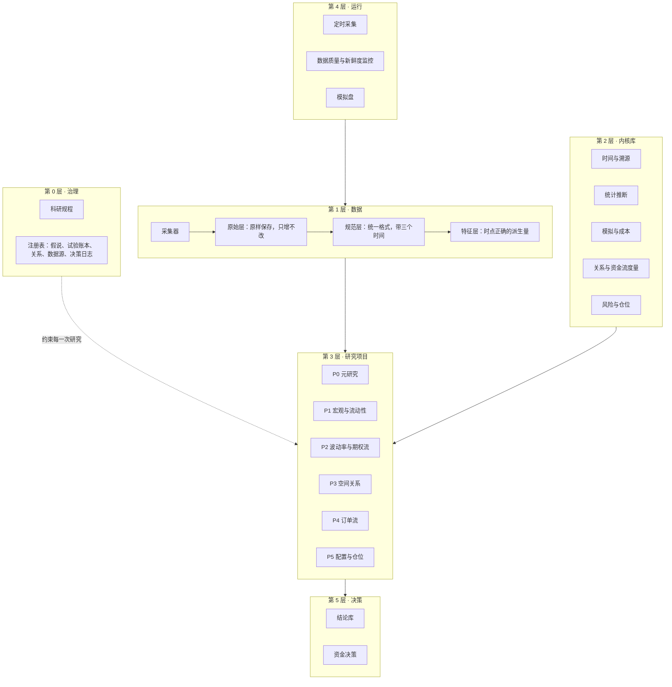

# 架构

本文描述系统分几层、每层负责什么、数据怎样流动。它是 Phase 1 开始写代码时的依据。标注"提议"的部分对应[决策记录](decisions/)里尚待所有者确认的条目。

## 1. 分层



| 层 | 职责 | 改动的代价 |
|---|---|---|
| 0 治理 | 规定什么算结论，记录做过什么 | 最高。历史记录缺失后无法补回 |
| 1 数据 | 把外部数据变成时点正确、可追溯的表 | 高。原始数据错过就没有了；时间语义定错要全部重建 |
| 2 内核库 | 可复用、有测试的计算 | 中。接口稳定后内部可以重写 |
| 3 研究项目 | 提出假说，执行检验，写报告 | 低。每个项目独立 |
| 4 运行 | 让第 1 层持续运转，并监控它 | 低 |
| 5 决策 | 把结论变成配置 | 低，但每个决策都要留痕 |

落地顺序基本按"改动代价从高到低"排列，详见[落地顺序](roadmap.md)。

## 2. 数据模型

### 2.1 三个时间

每条数据带三个时间字段：

| 字段 | 含义 | 例子：美国 10 月 CPI |
|---|---|---|
| `event_time` | 数据描述的时刻或时期 | 2026-10-31 |
| `available_at` | 公众最早能知道它的时刻 | 2026-11 中旬的公布时刻 |
| `ingested_at` | 我们抓取到它的时刻 | 抓取任务运行的时刻 |

研究代码只按 `available_at` 取数据。对于行情，`available_at` 等于事件时间加上数据源的延迟。对于没有历史、靠每天录制的数据，`available_at` 取 `ingested_at`。

会被修订的数据（多数宏观指标）同一个 `event_time` 有多条记录，每条对应一次公布。按时点查询时取"当时最新的那一条"。

### 2.2 三层存储

| 层 | 内容 | 规则 |
|---|---|---|
| 原始层 | 接口返回的原始字节，压缩保存，旁边附一个元数据文件：地址、参数、抓取时间、状态码、内容指纹、采集器版本 | 只增不改不删 |
| 规范层 | 按统一格式整理的 Parquet 表，按数据集和日期分区，带格式版本号 | 可随时删除，由原始层和代码重建 |
| 特征层 | 派生量，例如净 GEX、年化基差、订单流失衡 | 由规范层和代码计算，按指纹缓存 |

原始层是唯一不可替代的资产。代码写错了可以重算，原始数据没存就永远没有了。

### 2.3 时点查询接口

研究代码不直接读文件，只通过一个接口取数据。接口的含义是"在时刻 t，这张表里能知道的全部内容"。

每次研究运行有一个时钟上限。查询的时刻超过上限就报错。金库就是把上限设在封存边界上：没有所有者批准的令牌，任何查询都越不过去，而令牌的每次使用都写入账本。

这样，不前视和不碰金库都由接口保证，不依赖写代码的人或 AI 的自觉。

### 2.4 溯源

每个结果附带一份运行清单：

| 字段 | 含义 |
|---|---|
| 代码版本 | git 提交号 |
| 数据版本 | 用到的每个分区的内容指纹 |
| 配置指纹 | 全部参数的哈希 |
| 环境指纹 | 依赖锁定文件的哈希 |
| 随机种子 | — |
| 时钟上限 | 这次运行最远能看到哪一天 |

这些字段合成一个结果指纹。同一个结果指纹再跑一次，必须得到逐位相同的输出，这一点由持续集成检查。

## 3. 注册表

注册表是治理层的机器可读部分，放在仓库里，随代码一起做版本管理。

| 文件 | 格式 | 内容 | 写入规则 |
|---|---|---|---|
| `registry/hypotheses/` | 每个假说一个 YAML | 假说卡：机制、对手、证伪条件、检验方案、状态 | 检验方案冻结后不能改，只能追加状态 |
| `registry/trials.jsonl` | 每行一条 | 试验账本：每次在真实数据上产出绩效指标的运行 | 只追加，由程序自动写 |
| `registry/relations/` | 每条关系一个 YAML | 无套利关系：品种、公式、成本模型、价差存在的原因 | 可修订，保留历史 |
| `registry/sources/` | 每个数据源一个 YAML | 数据源目录：地址、时间语义、限流、使用条款摘要、已知问题 | 可修订 |
| `registry/decisions.jsonl` | 每行一条 | 决策日志：做了什么资金决策、依据哪些结论、当时的理由 | 只追加 |

持续集成检查三件事：文件格式合法；报告里引用的每个结果在账本里都有对应记录；只追加的文件没有被改动或删除过历史行。

## 4. 内核库

```
src/finresearch/
  core/        时间与日历、标识符、配置、溯源
  data/        采集器、存储、格式校验、时点查询
  stats/       多重检验、自助法、交叉验证、功效计算
  sim/         事件驱动的回测、成交与成本模型
  relations/   无套利关系的计算与残差
  flows/       订单流和期权流的度量
  risk/        风险度量、仓位、回撤控制
  report/      标准报告的生成
```

约定：

- 计算尽量写成纯函数，输入输出明确，不读写全局状态。
- 可调的数字全部放在配置文件里，代码里不出现魔法数字。
- 每个非平凡的函数都有一个手算期望值的测试。
- 时间一律用带时区的 UTC。

## 5. 研究项目

每个项目一个目录，内含它的假说卡引用、分析脚本和报告。项目之间互不依赖，只依赖内核库。

| 项目 | 研究的收益来源 | 现有基础 |
|---|---|---|
| P0 元研究 | 无。检验研究流程本身的误报率和检出率 | `orderflow` 的 `lab/stats` |
| P1 宏观与流动性 | 风险溢价的择时 | `market-weather-bot`；四层水晶球的首轮检验 |
| P2 波动率与期权流 | 波动率风险溢价；做市商对冲带来的结构性资金流 | Deribit 期权快照（自 2026-10-26）；CBOE 期权链指标 |
| P3 空间关系 | 套利受限处的价差 | `lab/spatial`：基差、资金费率、平价 |
| P4 订单流 | 流动性提供；短期的订单流失衡 | `orderflow` 的指标与回测引擎 |
| P5 配置与仓位 | 无。把已验证的结论和市场收益组合起来 | — |

## 6. 运行环境

### 6.1 计算

全部在 GitHub Actions 上运行，分四类工作流：

| 工作流 | 触发 | 作用 |
|---|---|---|
| 持续集成 | 每次提交 | 代码风格、类型检查、测试、注册表校验 |
| 采集 | 定时 | 抓取数据写入原始层，更新规范层 |
| 监控 | 定时 | 检查数据新鲜度和质量，异常时通知 |
| 研究运行 | 手动 | 执行一次已登记的试验，把结果和账本记录提交回仓库 |

### 6.2 存储（提议，见决策记录 0003）

代码仓库不存放数据。数据放在独立的私有存储里，通过一个统一的文件系统接口访问，更换后端只需要改配置。Phase 1 用不到远程存储，这个决定可以推迟到 Phase 2 开始时。

### 6.3 已经核实的约束

| 约束 | 数值 | 来源 |
|---|---|---|
| 公开仓库使用标准运行器 | 免费 | [GitHub 文档](https://docs.github.com/en/billing/managing-billing-for-github-actions/about-billing-for-github-actions) |
| 私有仓库（免费账户） | 每月 2,000 分钟 | 同上 |
| 单个文件 | 超过 100 MiB 被拒绝 | [GitHub 文档](https://docs.github.com/en/repositories/working-with-files/managing-large-files/about-large-files-on-github) |
| 仓库体积 | 建议 1 GB 以内 | 同上 |
| Hugging Face 免费账户 | 私有存储 100 GB | [Hugging Face 文档](https://huggingface.co/docs/hub/storage-limits) |
| Cloudflare R2 免费额度 | 每月 10 GB，流出流量不收费 | [Cloudflare](https://www.cloudflare.com/developer-platform/r2/) |
| Binance 接口 | 拒绝美国 IP；公开行情可改用 `data-api.binance.vision` 和 `data.binance.vision` | [Binance 文档](https://developers.binance.com/docs/binance-spot-api-docs/rest-api/public-api-definitions)；旧系统实测 |
| CBOE 延迟期权链原始文件 | SPX、SPY、QQQ、IBIT 四个标的压缩后合计约 3.5 MB/天，一年约 0.9 GB | 2026-11-13 实测 |

### 6.4 尚未核实，Phase 2 开始前要查清的事

- 公开仓库长期没有提交时，定时工作流是否会被自动停用，以及怎样避免。
- FRED 历史公布版本（宏观数据修订前的值）的免费获取方式。
- 每个数据源的使用条款是否允许个人存档。
- 从 GitHub Actions 读写 Hugging Face 或 R2 的速度和稳定性。

## 7. AI 助手的位置

AI 助手是研究委员会里各个角色的执行者（见[跨学科分析](disciplines.md)末尾），受以下规则约束：

| 可以做 | 不可以做 |
|---|---|
| 提出假说、起草假说卡 | 修改已冻结的检验方案 |
| 写代码和测试 | 改动或删除账本里的历史记录 |
| 在探索集上运行试验（自动记账） | 接触金库 |
| 写报告、审查别人的报告 | 审查自己提出的结论 |
| 发现问题时提出修订规程的建议 | 自行放行到下一级闸门 |

这些规则写在仓库根目录的 `CLAUDE.md` 里，其中能自动检查的部分由持续集成强制执行。
