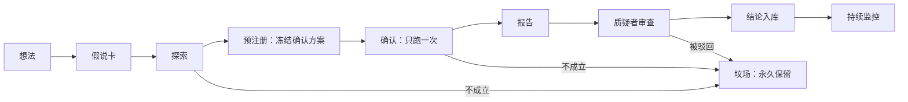

# 科研规程

本文规定一个想法怎样变成结论。它对人和 AI 助手同样适用。

## 1. 生命周期



| 阶段 | 做什么 | 产出 | 把关人 |
|---|---|---|---|
| 想法 | 记到待办里，一两句话 | 待办条目 | — |
| 假说卡 | 写清机制、对手、证伪条件、需要的数据，估算功效 | 假说卡，状态"草稿" | 理论员、数据员 |
| 探索 | 在探索集上研究，可以反复尝试，每次自动记账 | 账本记录，假说卡状态"探索中" | — |
| 预注册 | 冻结确认方案：样本范围、指标、检验方法、成本假设、成败阈值 | 假说卡追加"已注册"记录和方案指纹 | 统计审稿人 |
| 确认 | 在确认集上按冻结的方案运行一次 | 账本记录，标记"确认" | 统计审稿人 |
| 报告 | 按标准模板写 | 报告 | 工程师检查可重算 |
| 审查 | 独立会话寻找反例和更简单的解释 | 审查意见 | 质疑者 |
| 入库 | 记录结论、证据等级、保质期、复核日期 | 结论条目 | 所有者 |
| 监控 | 按预先登记的规则跟踪新数据 | 监控记录 | 风控官 |

探索可以跳过。如果检验只能用将来才录到的数据，就在写完假说卡后直接预注册，这是最干净的检验方式。

任何阶段被否定的假说进入坟场。坟场里的记录永不删除：它们计入试验次数，也避免以后重复研究同一个想法。

## 2. 假说卡

假说卡是一个 TOML 文件，放在 `registry/hypotheses/`，文件名就是编号。格式由 `src/finresearch/registry/models.py` 定义，持续集成逐个校验。下面是一个示例，尚未注册，仅作说明。

```toml
id = "H-0001"
title = "负 GEX 状态下，BTC 次日实现波动率更高"
program = "P4"
return_source = "structural_flow"   # 收益来源，见跨学科分析第 3 节；说不出就写 unknown
mechanism = "做市商净空 gamma 时，对冲方向与价格变动同向，放大波动。"
counterparty = "买入期权对冲或投机的一方；为波动放大付出代价的是短线逆势交易者"
why_persistent = "对冲是做市商的风控要求，不因被发现而停止"
why_us = "低频、小资金即可参与，不需要速度"
falsification = "按 GEX 符号分组后，次日实现波动率的差异在确认集上不显著，或方向相反，或加入 DVOL 作为控制变量后消失"
prior = 0.25                         # 研究开始前，认为它成立的概率
data = ["deribit.book_summary", "binance.klines_1m"]   # 必须是 registry/sources/ 里登记过的数据源
power = "每天一个观测。预期效应量 d = 0.5，阈值 t >= 3，功效 80%，两组天数相当时确认集约需 240 天。目前只录了 18 天。"

[scope]                              # 适用范围：结论只在这里成立，用到范围之外等于新假说
universe = "U1"
instruments = "BTC 永续合约"
horizon = "1 天"
output = "volatility"                # return 进组合模型，volatility 进风险模型

[plan]                               # 检验方案：注册之后冻结
metric = "次日实现波动率（5 分钟收益平方和）的组间差"
test = "分块自助法，块长 5 天，双侧"
controls = ["DVOL 水平", "星期几", "是否有重大数据公布"]
robustness = ["GEX 阈值上下浮动 20%", "去掉最极端的 2 天", "两种做市商方向假设"]
# threshold_t、dsr_min、pbo_max 不写就取 config/protocol.toml 的默认值；只能写得更严

[plan.exploration]
start = 2026-10-26
end = 2027-06-30

[plan.confirmation]
start = 2027-07-01
end = 2028-02-29

[plan.vault]
start = 2028-03-01
end = 2028-06-30

[[history]]                          # 状态记录，只能在末尾追加
at = 2026-11-13T04:00:00Z
status = "draft"
```

状态只能按 草稿 → 探索中 → 已注册 → 已确认 / 已否定 / 无定论 的方向前进，任何阶段都可以直接进入"已否定"。

注册的做法是追加一条状态为 `registered` 的记录，并写上检验方案的指纹（由 `finresearch registry plan-fingerprint` 算出）。此后检验方案一个字都不能改：改了，指纹就对不上，持续集成会失败；连同指纹一起改，与上一个版本的比对也会失败。

示例里的功效估计说明了一件事：很多假说现在无法检验，因为数据还不够。这种情况下正确的做法是现在把数据的三段边界定下来、继续录制、到期再检验。边界定下之后才录到的确认集和金库，是最干净的样本外数据。

## 3. 数据的三段划分

每个数据集按时间分成三段。

| 段 | 大致比例 | 用途 | 访问 |
|---|---|---|---|
| 探索集 | 最早的 60% | 提出和打磨假说 | 自由，但每次试验记账 |
| 确认集 | 中间的 25% | 检验已注册的假说 | 每个假说一次 |
| 金库 | 最近的 15% | 最终检验 | 需所有者批准，使用永久记录 |

以上比例适用于已有历史的数据。具体边界日期在每个数据集首次用于研究时确定并写入数据源目录，之后不再移动。

对于没有历史、只能从现在开始录制的数据（例如期权链），三段边界按未来的日期事先划定。这种情况下，确认集和金库本身就是前向数据。

已有历史的数据集，在边界定下之后新产生的数据不属于以上任何一段，它是前向数据，证据效力最高。

运行时由时点查询接口执行这些边界：探索运行最远只能看到探索集的终点；确认运行最远只能看到确认集的终点，且每个假说只有一次；越过金库边界需要所有者的令牌。

## 4. 证据等级

| 等级 | 条件 | 可以用来做什么 |
|---|---|---|
| E0 | 只有想法和机制 | 写假说卡 |
| E1 | 在探索集上成立。单独回测最高只能到这一级 | 继续研究 |
| E2 | 在确认集上，对整体模型的边际贡献显著，且通过多重检验折损 | 作为信号进入模型，标注"初步" |
| E3 | 在另一个研究宇宙或另一段时期复现，且机制的其他推论也成立 | 作为信号进入模型 |
| E4 | 注册之后的前向数据上成立，长度不短于事先算好的最短长度 | 可以进入模拟盘 |
| E5 | 模拟盘的表现落在预期分布之内 | 可以提交所有者考虑实盘 |

"机制的其他推论"是指：如果机制是真的，除了被检验的现象之外，还应当看到别的现象。例如，如果做市商对冲真的放大波动，那么效应应当在期权到期日前后更强。检验这些推论比反复检验同一个现象更有说服力。

## 5. 默认阈值

以下是默认值，记在 `config/protocol.toml`。一个假说注册时只能设定比默认值更严的阈值，注册之后不能再改。这些规则由注册表检查强制执行。

| 检验 | 默认阈值 | 说明 |
|---|---|---|
| t 统计量 | ≥ 3 | 有明确机制的假说可在注册时申请降到 2.5，需写明理由 |
| 折损夏普 | ≥ 0.95 | 按账本里该假说的全部试验次数折损 |
| 回测过拟合概率 | ≤ 0.10 | 仅适用于从多组参数里选优的情形 |
| 成本加倍 | 仍为正 | 假设的交易成本乘以 2 |
| 去掉最好的 2 笔 | 仍为正 | 沿用旧系统手册里的规则 |
| 参数扰动 | 上下 20% 内符号不变 | 结论不依赖某个精确的参数值 |
| 分段 | 多数子时期方向一致 | — |

这些数值在 Phase 3 的元研究里校准：把整条流程放在纯噪声上跑，量出实际的误报率，再据此定稿。校准之前它们是暂行值。

## 6. 信号的准入

所有研究的产出都是信号，所有信号进入同一个模型（[决策 0006](decisions/0006-single-model.md)）。所以一个信号是否有价值，不看它单独能否赚钱，而看它让整体变好了多少。

**准入检验。** 在相同的数据和约束下，分别运行包含和不包含这个信号的整体模型，比较两者扣成本后的样本外表现。检验方法和阈值在预注册时冻结，并记录当时作为基准的模型版本。

**单独回测的位置。** 单独回测用于诊断信号本身是否合理，最高只能支撑 E1。一个单独回测亏钱的信号，仍然可能因为与其他信号互补而通过准入。

**适用范围。** 每个信号登记它被验证过的研究宇宙、预测周期和市场条件。把它用到范围之外，等于提出一个新假说，必须重新检验。这条规则来自文艺复兴的一个公开教训：同一家机构的方法换了一个持仓周期就失效了（见[以文艺复兴为参照](renaissance.md)第 3 节）。

**预测波动而不是方向的信号**，进入风险模型，准入检验比较的是加入前后整体组合的风险调整后表现。

**组合模型本身的修改**，例如换一种合成方式，走同样的流程：新旧两个版本在同一份数据上比较，修改计入试验账本。

**退役。** 已进入模型的信号，按第 9 节的规则持续监控边际贡献，越过事先设定的界限即移出模型，并在结论库里记录。

## 7. 试验记账

**什么算一次试验：** 任何一次在真实数据上运行、并输出绩效或显著性指标的计算。

**什么不算：** 结果指纹完全相同的重复运行；在合成数据上的运行；不输出绩效指标的数据检查。

**怎么记：** 由运行框架自动写入 `registry/trials.jsonl`，不靠人工。每条记录包含假说编号、运行清单、结果指纹、用到的数据段、指标摘要，动用金库时还要引用所有者的批准。每条记录带有前一条记录的指纹，任何一条历史记录被改动或删除，持续集成都会失败。

自动执行的规则：

- 工作区有未提交改动的运行不能入账。
- 确认检验必须在注册之后，每个假说只有一次。
- 运行的时钟上限不能越过它所在数据段的终点。
- 金库试验必须引用所有者此前对该假说的开启决定。
- 状态为"已确认"或"无定论"的假说，账本里必须有它的确认检验。

**为什么自动：** 靠自觉记账的账本，漏记的恰恰是那些结果不好、被随手丢弃的尝试，而它们正是折损计算最需要的。

## 8. 标准报告

每份报告包含以下章节，缺一项即视为未完成。

1. 结论：一段话，包含效应方向、大小和不确定度。
2. 假说与机制：引用假说卡。
3. 数据：来源、时间范围、三段划分、已知缺陷。
4. 方法：与注册方案的任何偏离都要列出并说明原因。
5. 结果：效应量、置信区间、试验次数、折损后的显著性。
6. 边际贡献：加入整体模型前后的对比，以及基准模型的版本。
7. 稳健性：第 5 节表中各项。
8. 成本与容量。
9. 适用范围：研究宇宙、预测周期、市场条件。
10. 更简单的解释：列出至少两个，并说明为什么排除或无法排除。
11. 局限。
12. 运行清单：能让别人重算的全部信息。

## 9. 监控与停止

结论入库时登记三样东西：

- **保质期和复核日期。** 到期用新数据复核，不复核的结论自动降级。
- **失效判据。** 新数据上出现什么情况，判定结论已不成立。
- **停止规则**（对进入模型的信号和进入模拟盘的模型）。用序贯检验跟踪实际表现与预期分布的偏离，越过事先设定的界限即移出或停止，不等到"再看看"。

## 10. 修订本规程

规程本身可以改，但要走决策记录：写明改什么、为什么改、对已有结论有什么影响。修订不追溯放宽已注册假说的阈值。
